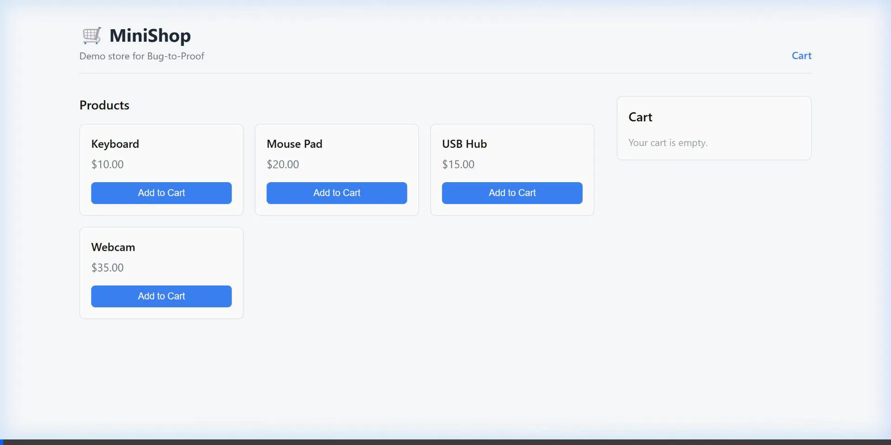

# Proofline demo recordings

**Proofline** is the product and dashboard name; `bug-to-proof` remains the repository identifier.

## Captioned product demo — 24 October 2026

[Watch the final Proofline demo](docs/evidence/portfolio/proofline-product-demo.mp4)

The 1 minute 26 second, 1080p/30 FPS edited demo uses an operator-supplied browser recording, explanatory captions, and supplied screenshots of the completed proof ZIP download and its file listing. It shows a MiniShop cart-total report, baseline failure, patch review, passing candidate checks, source-assisted investigation, and proof export. Browser chrome is removed; the original pacing of the first captioned edit is retained. The screenshots show download completion and archive contents, not a fresh independent integrity validation. No test was rerun or evidence altered for the edit. Verification is against a separate source copy and local app process, not a container or virtual machine. Earlier reference recordings below have their own provenance and are not substituted for this demo.

## Actual dashboard recording — 23 October 2026

[Watch the Proofline dashboard demo](docs/evidence/portfolio/proofline-dashboard-demo.mp4)

This continuous browser recording shows the real case register, searching, opening the report dialog, typing structured details, saving a report through the local API, and opening a separate retained reference case to inspect evidence and the proof-download control. API responses and case statuses are not mocked. It has no audio. The saved report is a demo description of a seeded defect, not a newly verified bug. The later reference case uses a deterministic repair proposal; no live-model repair runs during this recording.

To record again on Windows, start the local apps with `npm run dev`, then run `npm run demo:dashboard`. Chromium and FFmpeg must be installed. The recorder creates a real local demo report. The evidence runner retains the exact executed spec, screenshots, raw WebM, traces, and result under `artifacts/dashboard-recording/`. The MP4 is saved in `docs/evidence/portfolio/`.

## Current reference walkthrough — 22 October 2026

[Watch the 36-second MP4](docs/evidence/portfolio/reference-walkthrough.mp4)

The video walks through real captured browser evidence: the seeded cart-total failure, the deterministic one-line patch, the identical test passing afterward, and proof verification. Captions identify the scripted approval and reference-proposal boundary. It is an edited evidence walkthrough without audio, rather than continuous screen capture or live-model repair.

[Evidence, before/after screenshots, and provenance](docs/evidence/portfolio-reference.md) · [Run the reference demo](docs/demo-script.md)

## Historical recording

The animation below shows an earlier configured MiniShop demo, not the current reference run or arbitrary report generation.

