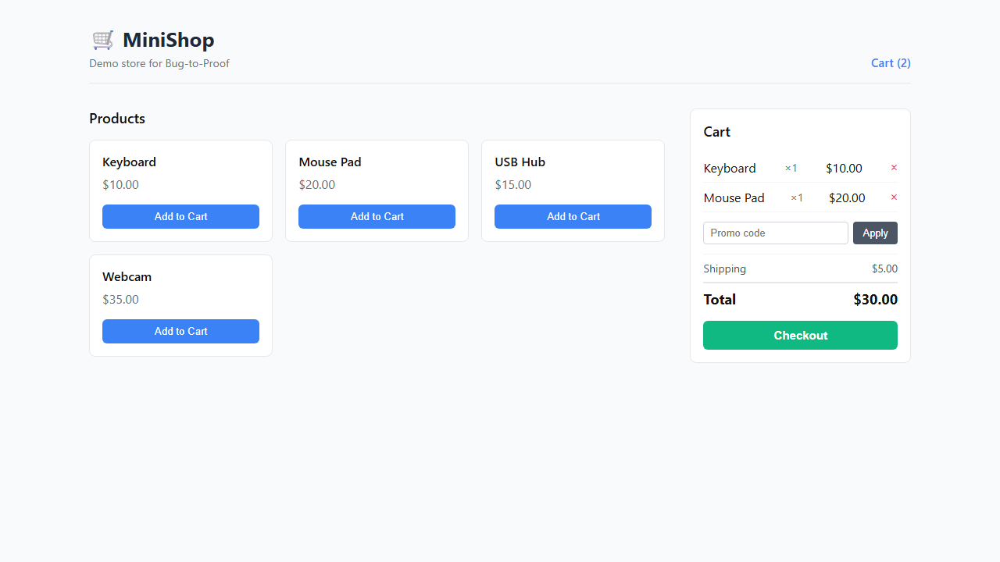

# Shareable reference evidence

Recorded **22 October 2026** using the project evidence runner against an isolated local MiniShop workspace. This is a configured-case reference: the test already exists, the repair proposal is deterministic, and approval is submitted by the script. It does not demonstrate independent human acceptance or live-model repair.

## Observed result

| Check | Recorded result |
| --- | --- |
| Bug | Cart total reads only the first item's price |
| Expected | Keyboard $10 + Mouse Pad $20 = $30 |
| Baseline | `ASSERTION_FAILED`, observed $10 |
| After isolated patch | `PASSED`, observed $30 |
| Reproduction identity | Same test fingerprint before and after |
| Regression gates | Typecheck, production build, MiniShop unit tests passed |
| Proof archive | Independently extracted; all 31 payload SHA-256 hashes matched |

Source run: `run-7157c831-a0eb-4c38-8d4f-53927ee0a9d7`.

The fix replaces the first-item lookup with a reduction over every item's price times quantity. Defect seeding and patch application occurred in the isolated workspace; the main MiniShop source was not edited.

## Recorded browser screenshots

**Before: the seeded defect displays $10.**


**After: the identical test passes with $30.**



## Video and provenance

- [36-second reference walkthrough](portfolio/reference-walkthrough.mp4): an edited sequence of these recorded screenshots and explanatory cards, without audio; not continuous screen capture.
- [Sanitized machine-readable summary](portfolio/summary.json): recording timestamp, test fingerprint, report hashes, regression outcomes, and original ZIP digest.
- [Rerun instructions](../demo-script.md).

The public files are an allowlisted subset. They exclude provider payloads, raw logs, case snapshots, local absolute paths, and the raw ZIP. The summary cannot independently reconstruct the complete run; complete evidence remains in the local Git-ignored run directory. Hashes establish consistency of the retained bytes, not independent authorship or correctness of the test's expectations.

To regenerate this subset after a successful reference run:

```sh
npm run demo:reference
npx tsx scripts/export-portfolio-evidence.ts
```

On Windows with FFmpeg installed, run `./scripts/record-portfolio-video.ps1` to rebuild the video. Inspect screenshots and captions before publication. If the source run changes, update this page's run identity and observed results from the new summary.

## Separate live-model result

The frozen v5 cohort recorded **10/12 reviewed report-matched reproductions** and **0/2 control false positives**. Those are reproduction-generation results on synthetic MiniShop variants, not repair success rates. See [the v5 evaluation](prospective-v5-live-evaluation.md).

## Current release checks

Local monorepo typechecking and both production builds passed on 22 October 2026. The restricted full-suite attempt encountered temporary-module access and loopback connection failures; those are environment failures. The unrestricted full-suite rerun **passed 358/358 tests across 75 files**, exit code 0, in 298.68 seconds. Output was buffered until completion. The successful reference run separately completed its three required MiniShop regression gates. Hosted CI has not been established: the connected GitHub account has read-only access and the local CLI login is invalid.

Release logs are retained locally under `artifacts/portfolio-release/`: `typecheck.log`, `build.log`, `unit.log`, `unit-unrestricted.log`, and `workflow-unrestricted.log`. Workflow changes add a manual trigger and match the documented serial unit command. They have not been pushed or run on GitHub.
